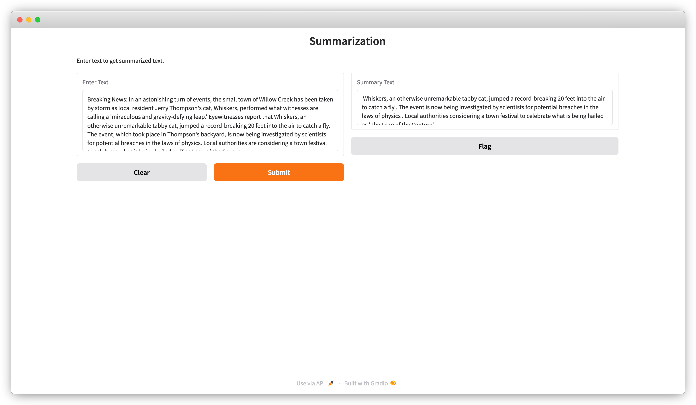

<div align="center">
    <h1 align="center">Add a UI to a BentoML Service with Gradio</h1>
</div>

[Gradio](https://github.com/gradio-app/gradio) is an open-source Python package that allows you to quickly build a web application for your model, API, or any arbitrary Python function. This project demonstrates how to add a Gradio web UI to a BentoML Service.

## Install dependencies

```bash
git clone https://github.com/bentoml/BentoGradio.git
cd BentoGradio

# Recommend Python 3.11
pip install -r requirements.txt
```

## Run the BentoML Service

We have defined a BentoML Service in `service.py`. Run `bentoml serve` in your project directory to start the Service.

```python
$ bentoml serve .
```

You can access the Gradio web UI at http://localhost:3000/ui.



For detailed explanations, see [the BentoML documentation](https://docs.bentoml.com/en/latest/build-with-bentoml/gradio.html).

For custom deployment in your own infrastructure, use [BentoML to generate an OCI-compliant image](https://docs.bentoml.com/en/latest/get-started/packaging-for-deployment.html).
